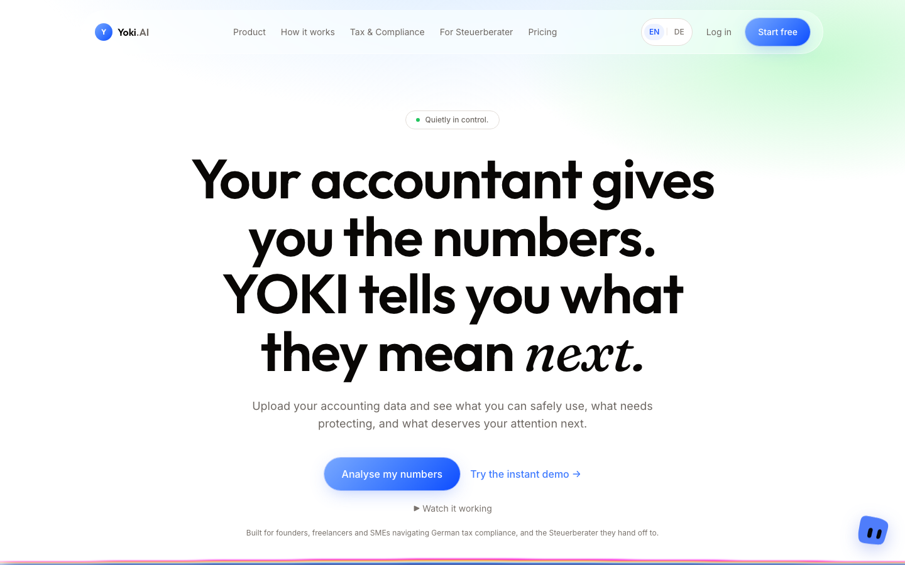
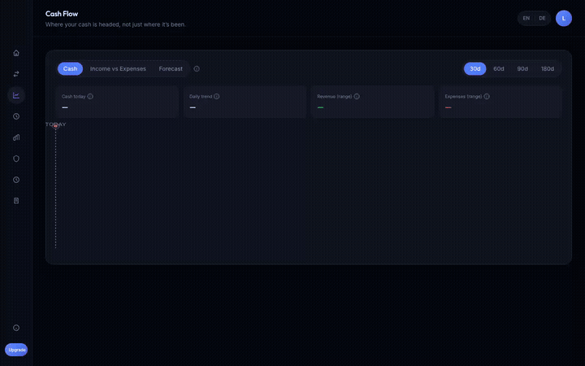
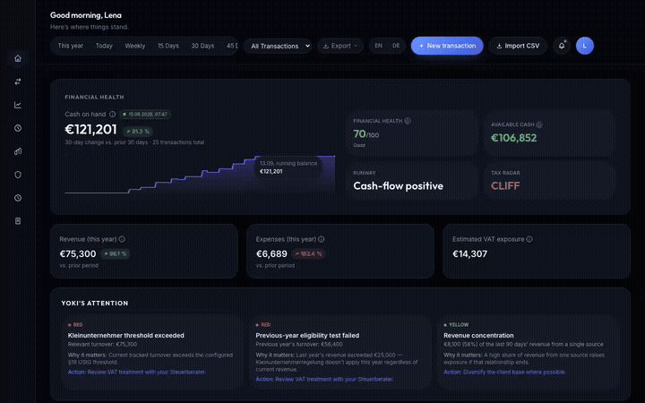
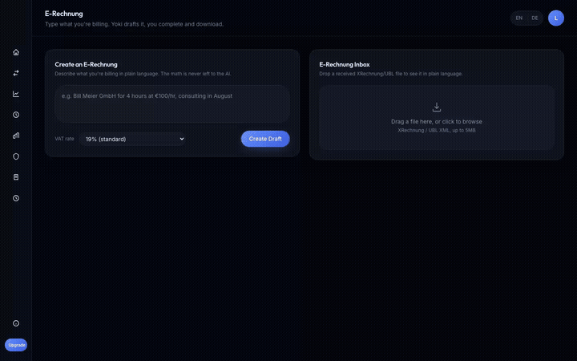

  

<h1 align="center">Yoki.AI</h1>

<em>quietly in control.</em>

<h3 align="center">You crossed the €100,000 VAT line in March. Your Steuerberater tells you in June.</h3>

  Yoki reads your bank export and shows what is safe to spend, what is already owed, and which German tax line
  you are about to cross, before the monthly close turns it into a surprise.

  
  
  
  

<a href="#the-problem">The problem</a> · <a href="#see-it-work">See it work</a> · <a href="#what-you-get">What you get</a> · <a href="#for-steuerberater">For Steuerberater</a> · <a href="#honest-notes">Honest notes</a> · <a href="#access">Access</a>

---

## The problem

Your bank balance is not your money. Part of it is VAT you collected, part is bills already due, part is next
quarter's prepayment. Bookkeeping tools tell you what already happened. Nobody tells you what happens next.

Since 2025 Germany's €100,000 Kleinunternehmer threshold (§19 UStG) is a hard, real-time cutoff: cross it
mid-year and VAT applies from that invoice onward, not from January. Most founders find out from their
Steuerberater weeks later, after the prices, invoices and hires that caused it.

## See it work

| Upload your numbers | See what is safe to spend |
|---|---|
|  |  |
| **Test a decision before you make it** | **E-invoice ready** |
|  |  |

Click any preview for the full-quality video.

## What you get

- **Safe to use.** Bank balance minus VAT reserve minus upcoming bills, shown as one number, with the working
  shown so you can check every line.
- **Tax Radar.** Live tracking of the §19 UStG threshold, so you see the line coming instead of learning you
  crossed it.
- **Action Queue.** Runway, VAT reserve, overcommitted cash, unusual expenses and receivables at risk. Every
  item carries the transactions behind it, not just a verdict.
- **Scenarios.** Hire someone, lose a client, raise prices: run it against your real ledger and see runway and
  threshold status change before you commit.
- **Ask Yoki.** Ask questions about your own numbers in plain language. Read-only: it never changes your data.
- **German bookkeeping that holds up.** GoBD-oriented audit trail and DATEV EXTF export for your Steuerberater.

## For Steuerberater

One screen for up to 10 client businesses: every risk signal across your portfolio without logging into each
client separately. Your clients arrive at the monthly close with fewer surprises, and you spend the meeting on
advice instead of reconstruction.

## Honest notes

- **Upload, not live sync (yet).** Yoki reads a bank CSV or manual entries, the same kind of export sevdesk or
  Lexware produce. A live bank feed is not built yet.
- **Not tax advice.** Yoki shows the calculation and its sources. Always confirm decisions with your Steuerberater.
- **Not a bookkeeping replacement.** It is the forward-looking layer your bookkeeping does not have.

## Access

Yoki is live at **[yoki-ai-fintech.fly.dev](https://yoki-ai-fintech.fly.dev)**: start with the instant demo.

  

For partnerships, pilots with your Steuerberater practice, or press, reach out through
[GitHub](https://github.com/SuryaThakur999).

---

This repository is a product showcase and contains no source code. Yoki.AI is proprietary software,
all rights reserved. See [LICENSE](LICENSE).
